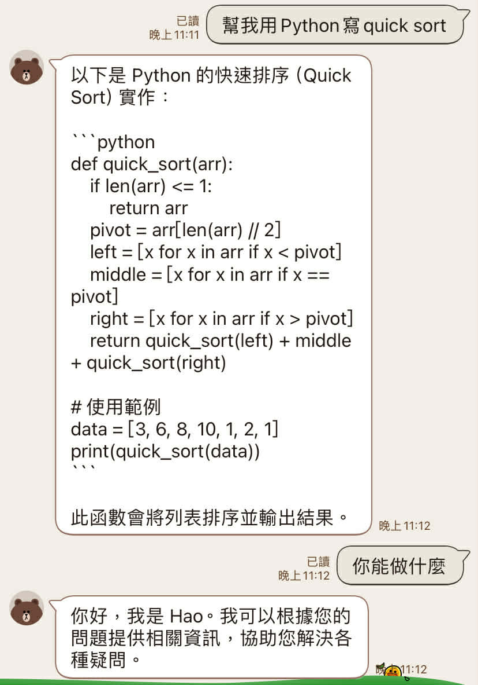

# hao-for-you

智慧助理 API server

## Table of Contents

- [專案結構](#專案結構)
- [功能](#功能)
- [環境需求](#環境需求)
- [環境變數](#環境變數)
- [本地開發](#本地開發)
- [Docker 啟動](#docker-啟動)
- [LINE example](#line-example)
- [常用指令](#常用指令)

## 專案結構

```text
.
├── app
│   ├── api
│   │   ├── api.py
│   │   └── chatbot_router.py
│   ├── core
│   │   ├── config.py
│   │   └── logger_settings.yml
│   ├── schemas
│   │   └── cahtbot_schema.py
│   ├── service
│   │   ├── logger_service.py
│   │   └── util_service.py
│   └── main.py
├── deployment
│   ├── docker-compose.yaml
│   └── init.sh
├── tests
├── Dockerfile
├── Dockerfile.ollama
├── pyproject.toml
├── run.py
└── uv.lock
```

## 功能

- FastAPI server health check
- Echo API
- Ollama API 測試 endpoint
- LINE Bot webhook callback
- Docker Compose 啟動 API 與 Ollama
- 使用 `uv` 管理 Python dependency

## 環境需求

- Python 3.10
- uv
- Docker / Docker Compose

## 快速開始
- 建立`.env`，參考"環境變數" part
- 啟動
```
>> cd hao-for-you
>> bash ./deployment/init.sh
```


## 環境變數

- 本地開發可以建立 `.env`，參考 .env.example 的範例創建一個 .env file：
```env
HOST=
PORT=
DEBUG=
ENV=prod
OLLAMA_MODEL=qwen3.5:0.4b
```

- Docker Compose 部署時，API container 會使用：
```env
ENV=prod
OLLAMA_BASE_URL=http://ollama:11434
```
`app/core/config.py` 目前的預設行為：

- `dev`: `http://localhost:11434`
- `prod`: `http://ollama:11434`

## 本地開發流程

- cloe repo
```bash
git clone git@github.com:eating-chen/hao-for-you.git
cd hao-for-you
```

- 安裝套件(如果沒有uv 須先安裝 uv)：
    - 安裝 uv
    ```bash
    curl -LsSf https://astral.sh/uv/install.sh | sh
    ```
    - 安裝此環境依賴
    ```bash
    uv sync
    ```

- 啟動 dev api server：
```bash
uv run python run.py --dev
```

- 預設會啟動在：
```text
http://localhost:8008
```

- 本地測試的話模型需要先用 ollama 指令起一個自己的model，到 `.env` 裡面去設定 `OLLAMA_MODEL`，ex: qwen3.5:0.8b

- 可以透過 http://localhost:8008/docs 去看 api 文件(FastAPI seagger UI)

- 可以透過 FastAPI seagger UI 自己打 api 或是透過 curl 測試ollama:
```bash
curl -X 'POST' \
  'http://localhost:8008/test_ollama' \
  -H 'accept: application/json' \
  -H 'Content-Type: application/json' \
  -d '{
  "prompt": "hi"
}'
###
"你好！我是 Hao，你的 AI 助手。\n\n請問有什麼可以幫你的嗎？"
```


- 執行測試：
```bash
uv run pytest
```

## Docker 啟動

- 啟動 API 與 Ollama，並初始化 model(預設是 qwen3.5:0.8b)：
```bash
./deployment/init.sh <your-local-model>
```

- 這段啟動完之後，需要用 ngrok 去設定本地的port 並到 LINE DEVELOPER 上做設定，之後就可以看到嘗試到 [LINE example](#line-example) 看結果


- 手動使用 Docker Compose，但ollama須自己載入 model：
```bash
docker compose -f deployment/docker-compose.yaml up -d --build
```

- 停止服務：
```bash
docker compose -f deployment/docker-compose.yaml down
```

- Ollama model 會存在 Docker volume：
```text
ollama-data:/root/.ollama
```

## LINE example
- 如果是本地開發的話需先用 ngrok 開出對外的 port 並到 LINE DEVELOPER 設定
- 設定完 LINE_CHANNEL_SECRET 跟 LINE_CHANNEL_ACCESS_TOKEN 後，透過 QR code 掃 Hao for you 的聊天視窗，就可以跟 AI 進行對話
- 截圖如下:
     
    

## 常用指令

重新 build API image：

```bash
docker build -t hao-for-you .
```

重新 build Ollama image：

```bash
docker build -f Dockerfile.ollama -t hao-ollama .
```

查看 compose logs：

```bash
docker compose -f deployment/docker-compose.yaml logs -f
```

查看 API logs：

```bash
docker compose -f deployment/docker-compose.yaml logs -f api
```

查看 Ollama logs：

```bash
docker compose -f deployment/docker-compose.yaml logs -f ollama
```
